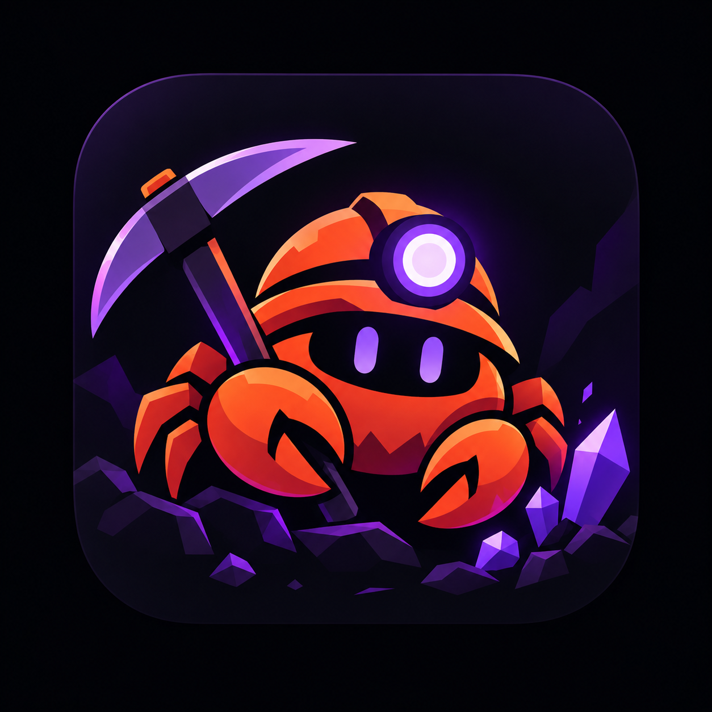

<p align="center">
  
</p>

<h1 align="center">Rustpick</h1>

<p align="center">
  A modern desktop app and command-line tool for earning eligible Twitch Drops without playing video.
</p>

> [!IMPORTANT]
> Rustpick is an early preview. Packaged downloads and Homebrew installs are planned, but are not available yet. Developers can build it from source today.

## What is Rustpick?

Rustpick keeps track of your eligible Twitch Drops campaigns, watches matching channels in the background, and claims rewards when they are ready. It does not play or download the video stream.

It is a Rust port of [TwitchDropsMiner](https://github.com/DevilXD/TwitchDropsMiner) with a shared mining engine and two ways to use it:

- **Desktop app:** a visual interface for campaigns, progress, White list and Black list filtering, settings, and tray operation
- **CLI:** a lightweight headless option for terminals, servers, and automation

Rustpick can switch channels when a stream goes offline or a higher-priority game becomes available. Sign-in uses Twitch's device-code page, so Rustpick never asks for your Twitch password.

## Why use it?

- Earn eligible Drops while Rustpick runs unattended
- Avoid streaming video just to make campaign progress
- See campaigns and progress in one place
- Switch between a White list of games to mine and a Black list of games to skip
- Run either a desktop app or a headless CLI backed by the same core
- Import settings and an existing login session from TwitchDropsMiner

## See it in action

The desktop app includes **Main**, **Inventory**, **Settings**, and **Help** views, plus a tray mode.

> Screenshots are coming as the early desktop interface stabilizes.

<!-- Add the first desktop screenshot here when ready:
<p align="center">
  
</p>
-->

## Installation

### Planned downloads

GitHub Releases will be the main source for ready-to-run CLI binaries and desktop packages. The initial targets are macOS on Apple Silicon and Intel, Windows on x86-64, and Linux on x86-64. A Homebrew formula for the CLI and a Homebrew cask for the macOS app are also planned.

The intended Homebrew experience is:

```sh
# Planned, not available yet
brew install rustpick
brew install --cask rustpick
```

The formula will install the CLI. The cask will install the macOS desktop app.

### Build from source

You need a current [Rust toolchain](https://rustup.rs/). Building the desktop app also requires Node.js and npm.

Build and run the CLI:

```sh
cargo build --release -p rustpick
./target/release/rustpick
```

Build the desktop app:

```sh
cd rustpick-gui/ui
npm ci
cd ..
npm run tauri build
```

## Getting started

### Desktop

1. Open Rustpick.
2. Follow the sign-in prompt and enter the shown code at `twitch.tv/activate`.
3. Review your campaigns and turn on the White list, the Black list, or neither to mine everything.
4. Leave Rustpick running while it works. It can stay in the system tray.

### CLI

Run Rustpick with no command to start mining in the terminal UI:

```sh
rustpick
```

On first run, open the activation page shown in the popup and enter the device code. The UI has a
Main tab (progress, channels, output) and a Log tab. Keys: `1`/`2` switch tabs, `j`/`k` move,
`Enter` watches the selected channel, `p` pauses, `r` reloads, `q` quits. Press `/` for commands
(`watch <channel>`, `auto`, `pause`, `resume`, `reload`, `quit`), with `Tab` to complete. In the UI,
logs go to `log.txt` and the Log tab. When output isn't a terminal, or with `rustpick run`, Rustpick
prints plain lines instead, which suits services and Docker.

Useful commands include:

```sh
rustpick priority "Game A" "Game B"  # White list, highest priority first
rustpick set whitelist true           # Mine only White-listed games
rustpick exclude "Game C"            # Black list
rustpick set blacklist true           # Never mine Black-listed games (default on)
rustpick set linked-only false        # Also mine campaigns without a linked game account
rustpick order ending-soonest         # Order for games the White list doesn't rank
rustpick claims                       # Show claimed-drop history
rustpick status                       # What the running miner is doing
rustpick check                        # Test proxy, login, GQL and PubSub; exits 1 on failure
rustpick run --metrics 127.0.0.1:9184 # Also serve Prometheus metrics
rustpick unlinked                     # Active campaigns that need a linked game account
rustpick active-hours 22-6            # Only mine between 22:00 and 06:00 local time ("off" to stop)
rustpick autostart on                 # Start Rustpick when you sign in
rustpick logout                       # Forget the saved Twitch token
rustpick --help                       # Show every command and option
```

To move from TwitchDropsMiner:

```sh
rustpick import ~/TwitchDropsMiner
```

This imports its settings and, when available, its `cookies.jar` login session.

After a restart Rustpick goes straight back to the channel it was watching (if the previous run
ended less than 3 hours ago and the channel still qualifies) while discovery runs. Once a day it
checks GitHub for a newer release and only tells you about it; turn that off with
`"check_updates": false`. The desktop app has a Log tab with level filter, search and copy.

### Multiple accounts

Each profile has its own settings, login and lock, and runs as its own process:

```sh
rustpick --profile main
rustpick --profile alt
rustpick-gui --profile alt            # separate window and tray icon
```

Profiles live in the user config directory (`~/Library/Application Support/rustpick/<name>` on
macOS, `~/.config/rustpick/<name>` on Linux, `%APPDATA%\rustpick\<name>` on Windows).
Autostart entries are per profile. `RUSTPICK_DIR` still overrides everything.

### Docker

```sh
docker compose up -d && docker compose logs -f   # enter the shown code once
```

See `docker-compose.yml`. Data lives in the `/data` volume, the health check fails when the miner
stops updating `status.json`, and images are published to `ghcr.io/ydw1904/rustpick` on tags.
Any of `RUSTPICK_PROXY`, `RUSTPICK_NOTIFY_URL`, `RUSTPICK_LANGUAGE`, `RUSTPICK_WHITELIST`, `RUSTPICK_BLACKLIST`,
`RUSTPICK_LINKED_ONLY`, `RUSTPICK_ORDER`, `RUSTPICK_CONNECTION_QUALITY`, `RUSTPICK_ACTIVE_HOURS` and the comma-separated
`RUSTPICK_PRIORITY` / `RUSTPICK_EXCLUDE` override `settings.json` (and get saved into it).

## Current status

Rustpick is an early port. The following pieces are implemented:

- Device-code login, inventory and campaign loading, eligibility checks, and claiming
- Channel discovery and automatic switching when streams change
- Drop progress tracking with fallback checks
- Independent White list and Black list toggles, a linked-accounts-only switch, and two mining orders
- Desktop, tray, autostart, notifications, and a headless CLI
- Translated core messages using TwitchDropsMiner language files

The post-login flow has automated tests and compiles, but has not yet been fully tested with a live Twitch account. Expect rough edges until the first public release.

## Data and security

By default, `settings.json`, `auth.json`, `claims.jsonl`, `status.json`, `log.txt`, and `lock.file` are stored in the directory where Rustpick runs. The desktop app opened from Finder uses `~/Library/Application Support/rustpick` instead. Set `RUSTPICK_DIR` to use a different data directory.

`auth.json` contains your Twitch access token. Treat it like a password and do not share or commit it. Rustpick allows only one miner per data directory at a time.

## For developers

The desktop app and CLI share the same Rust mining core. The CLI lives in `src/bin/cli.rs`; the Tauri desktop app lives in `rustpick-gui/`, with its React interface in `rustpick-gui/ui/`.

Run the desktop app with hot reload:

```sh
cd rustpick-gui
npm run tauri dev
```

Tauri commands must run from `rustpick-gui/`, not `rustpick-gui/ui/`. A plain Cargo build of the GUI expects the Vite development server; use the Tauri commands above for the complete workflow.

On macOS, if a newer SDK is incompatible with the installed linker, select an older installed SDK with `SDKROOT` before the build command.

## Disclaimer

Rustpick is an independent open-source project. It is not affiliated with, endorsed by, or sponsored by Twitch Interactive, Inc. Twitch and Twitch Drops are trademarks of their respective owner.

Use Rustpick responsibly and review Twitch's current terms before using automation with your account.

## License

[GPL-3.0](LICENSE), matching TwitchDropsMiner.
